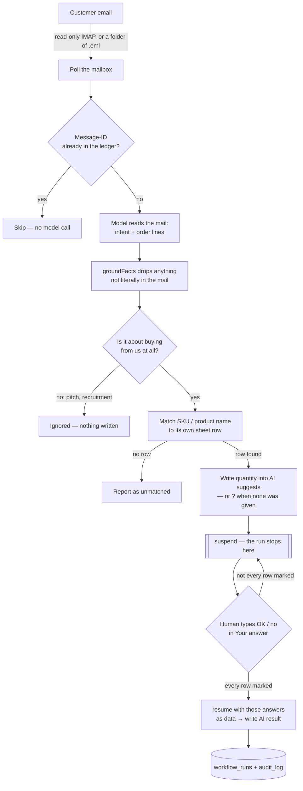

# sheetflow-ai

**Turns order emails into filled-in Excel rows. You approve. No data entry.**

A customer emails an order. sheetflow reads the mail, works out which rows of **your own Excel
file** it is talking about, drafts the quantity into those rows, and then stops and waits. You
decide by typing `OK` or `no` in the sheet you were already looking at. Nothing is applied until
you do.

Sibling of [`langorder-ai`](https://github.com/swnotmetal/langorder-ai) (enterprise, LangGraph +
ERPNext). Same safety story, no new infrastructure: the spreadsheet is the database and the UI.

## Who this is for

High-volume, low-to-mid-ticket, repeatable orders — the cheap, bulky, "same thing every week" kind.
The higher the ticket, the more the salesperson, never a machine, should sit between the customer
and the deal. What sheetflow actually replaces is the person in the middle who copies rows by hand
between Outlook and the warehouse sheet — not the salesperson.

Non-English and complex product text is the highest-risk axis for hallucination, so the rule stays
"copy exactly, never paraphrase, drop anything not literally in the mail" (`groundFacts`) rather
than trusting the model's structured output.

## The loop



The AI writes to three columns and nothing else. These columns **are the interface** — there is no
other screen to learn:

| Column | Who writes it | What it means |
| --- | --- | --- |
| `AI suggests` | the AI | the quantity for that row, or `?` when the mail named the item but gave no quantity |
| `Your answer: OK or no` | **you** | type `OK` to accept, `no` to reject, or leave it blank to wait |
| `AI result` | the AI | `recorded ✓` or `cleared` — confirmation that your answer was picked up |

The three columns are created the first time the tool runs against your file, **before any mail is
read**, so you can see where they are. The working columns are transient by design — a rejected
draft is cleared, a new order reuses the same rows — so a second sheet, `Log`, is appended to and
never rewritten:

| When (UTC) | Mail | What the AI did | Your answer | Result |
| --- | --- | --- | --- | --- |
| 2026-10-28 09:12 | `<mix-01@…>` | row 2 · AP-TSH-BLK-M · 40 units | OK | recorded ✓ |
| 2026-10-28 09:20 | `<mix-05@…>` | not a purchase | — | ignored |

Rejecting a row deletes the suggestion from the working column; the `Log` sheet keeps the history.
Existing cells, formulas and number formats are never rewritten. There is no email composer and no
reply is sent — see *Limits*.

## Why Mastra

LangGraph models a graph of nodes you run to the end. Mastra models the same graph but treats
**stopping for a human as a primitive**: a step calls `suspend()`, the run's state is written to
storage, and the process can exit. Later, `resume()` re-attaches to that saved state and continues
from the step that stopped — no loop, no polling table, no replay of the earlier steps.

In this repo that is one line in `src/workflow.ts`:

```ts
return suspend({ messageId, rows, unmatched }, { resumeLabel: 'sheet-review' });
```

and the answer comes back the way the framework intends — as data, not as a file the step goes and
re-reads:

```ts
await run.resume({ step: 'review', resumeData: { decisions: [{ row: 9, decision: 'approved' }] } });
```

`npm run inbox` starts a run, drafts, and waits up to `SHEETFLOW_REVIEW_TIMEOUT_MS` **for the whole
pass** — ten minutes by default, not ten per mail. Whatever is still unmarked stays suspended **on
disk** (`src/state.ts`, LibSQL); the next `npm run inbox` — another process, the next morning —
resumes exactly where it stopped.

## Stack

| Layer | Choice | Why |
| --- | --- | --- |
| Orchestration | [Mastra](https://mastra.ai) | `suspend`/`resume` with durable snapshots |
| Model | `LLM_PROFILE` → one model | `aws` (Nova Lite) · `openai` · `anthropic` · `groq` · `deepseek` · `local` |
| Mail | `imapflow` + `mailparser` | read-only IMAP; `.eml` folder when no credentials |
| Excel | `exceljs` | atomic temp→rename + `.bak`, formulas preserved |
| Ledger | `better-sqlite3` | dedupe by `Message-ID`, append-only audit |

## Run

```powershell
npm install
Copy-Item test/inventory.xlsx orders.xlsx   # a scratch copy, never the fixture
Copy-Item .env.example .env                 # LLM_PROFILE=aws, WORKBOOK_PATH=./orders.xlsx
npm run inbox
```

```powershell
npm test           # 72 deterministic tests, no model calls
npm run test:live  # one real Bedrock call: .eml → draft → mark → resume
```

**Where do you type the answer?** Columns `L`, `M`, `N` on `Sheet1`, to the right of `Status`: a dark
header, and — **only on rows that have a suggestion** — a light highlight with a **dropdown with `OK`
and `no`**. Rows with nothing to answer stay plain, so the sheet itself shows you what is waiting.
They are created before any mail is read, so if the file was already open in Excel, close it and
reopen it to see them.

**Excel holds the file open for writing.** The tool can read an open workbook and keeps your
decision safely in its own ledger, but it cannot rewrite the file: save and close it and the next
pass fills in `AI result` and the `Log` sheet. A mail it could not draft because of the lock is
deferred and retried, never dropped. Every later pass also re-reads `AI result` and re-writes any
receipt the workbook is missing — including one lost when an older copy of the file was saved over
it — so the sheet catches up on its own.

**A run left undecided never blocks new mail.** The next pass reads the sheet once: answered rows are
finished, unanswered ones are listed and left waiting. If the workbook was replaced and those rows no
longer exist, `npm run inbox -- forget-waiting` drops the waiting runs so the same mail can be
drafted again; `npm run inbox -- retry-failed` does the same for runs that died on an error.

**Who decides, and how it reaches the graph.** The driver reads your answers off the sheet and hands
them to the suspended run as `resumeData: { decisions: [{ row, decision }] }` — the same contract
Mastra and LangGraph document (`resume()` / `Command(resume=...)`). The run itself touches no file
while it resumes, so a workbook that Excel is holding can delay a write-back but can never break a
decision, and any other collector (a form, a chat reply, Google Sheets) later plugs into the same
call without changing the graph.

## Why a local `.xlsx`, and what it costs

A garage or a small distributor already works in Excel, offline, on a machine where nobody will
install anything. The sheet *is* the interface: no login, no new app, no second inbox. That is the
reason this project starts there, and it is a deliberate trade, not an oversight:

- **A file is not a database.** Two writers (this tool, and a human with the file open) cannot both
  be right, so every write is atomic (temp → rename, with a `.bak`), locks are retried, and a
  decision is always recorded in the ledger before the workbook is touched.
- **The workbook can be replaced or reverted.** So the ledger is the source of truth and the sheet
  is a projection of it: the next pass re-writes any receipt the sheet is missing.
- **Row numbers are the only shared key.** That is why a line the sheet does not contain is
  reported (`unmatched`), never guessed.

Google Sheets is the next target: the same columns and the same resume contract, behind an API that
has revisions, so no lock handling and no "save and close". The workflow does not change; only
`src/excel.ts` and the driver's read/write calls do.

## Limits (deliberate)

- **No reply is composed or sent.** An approved row is recorded in the sheet; `src/outbound.ts`
  still refuses to claim a delivery. If a reply is ever added, its draft belongs in a fourth column
  and its confirmation in the same `Your answer` column — never a new tool to learn.
- **Intent is a label, not a gate on questions.** A mail is an `order` when it carries a quantity;
  otherwise it is a `question` and **still reaches the sheet** with `?`, because "do you have any
  black crew socks?" is not for this project to interpret. Only `other` (recruitment, vendor
  pitches, newsletters) is suppressed.
- **Model labels are not trusted.** Nova Lite called 3 of 10 plainly quantified orders a
  "question"; the label is recorded in the audit only when it disagreed with the text.
- **Injected instructions are not obeyed, but can silence a mail.** A `[SYSTEM NOTICE: …]` made
  Nova Lite return nothing: no leak, no wrong row, but the order went out as `ignored`. The audit
  records “quantities in the text but no lines extracted” so it is inspectable.
- AWS is the tested profile: `eu.amazon.nova-lite-v1:0`, `eu-north-1`, ambient AWS credentials.
