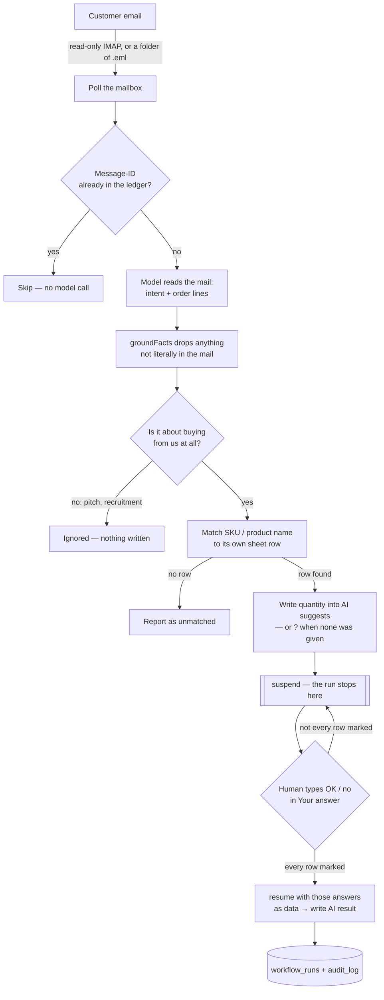

# sheetflow-ai

**Turns order emails into filled-in Excel rows. You approve. No data entry.**

A customer emails an order. sheetflow reads the mail, works out which rows of **your own Excel
file** it is talking about, drafts the quantity into those rows, and then stops and waits. You
decide by typing `OK` or `no` in the sheet you were already looking at. Nothing is applied until
you do.

Sibling of [`langorder-ai`](https://github.com/swnotmetal/langorder-ai) (enterprise, LangGraph +
ERPNext). Same safety story, and nothing to run beside it: the spreadsheet is the database and the
UI. (The tool itself is one executable on the shop's own PC — see *Run it for a shop*.)

## Who this is for

High-volume, low-to-mid-ticket, repeatable orders — the cheap, bulky, "same thing every week" kind.
The higher the ticket, the more the salesperson, never a machine, should sit between the customer
and the deal. What sheetflow actually replaces is the person in the middle who copies rows by hand
between Outlook and the warehouse sheet — not the salesperson.

Non-English and complex product text is the highest-risk axis for hallucination, so the rule stays
"copy exactly, never paraphrase, drop anything not literally in the mail" (`groundFacts`) rather
than trusting the model's structured output.

## The loop



The AI writes to three columns and nothing else. These columns **are the interface** — there is no
other screen to learn:

| Column | Who writes it | What it means |
| --- | --- | --- |
| `AI suggests` | the AI | `48 · Oversized Tee - Black - M` — the amount, then **the mail's own words for it**; `?` instead of an amount when the mail named the item but gave no quantity. A note on the cell says which mail, from whom, when. |
| `Your answer: OK or no` | **you** | type `OK` to accept, `no` to reject, or leave it blank to wait |
| `AI result` | the AI | `recorded ✓` or `cleared` — confirmation that your answer was picked up |

The three columns are created the first time the tool runs against your file, **before any mail is
read**, so you can see where they are. The working columns are transient by design — a rejected
draft is cleared, a new order reuses the same rows — so a second sheet, `Log`, is appended to and
never rewritten:

| When (UTC) | Mail | What the AI did | Your answer | Result |
| --- | --- | --- | --- | --- |
| 2026-10-28 09:12 | 2026-10-28 09:10 UTC · ACME GmbH \<orders@acme> — "PO 4500" | row 2 · 48 · Oversized Tee - Black - M | OK | recorded ✓ |
| 2026-10-28 09:20 | 2026-10-28 09:19 UTC · jobs@agency — "Vacancy" | not a purchase | — | ignored |

Rejecting a row deletes the suggestion from the working column; the `Log` sheet keeps the history.
Existing cells, formulas and number formats are never rewritten. There is no email composer and no
reply is sent — see *Limits*.

**When something goes wrong, it goes wrong here too.** If a mail could not be read, a saved run is
unreadable, or the workbook was locked when the answer should have been recorded, that becomes a row
in `Log` with `Your answer` left as `—`. The sheet is the only interface, so an error that exists
only in a terminal nobody is watching does not count. A failure caused by the file being open in
Excel cannot be written at the moment it happens — it is queued in the ledger and written by the next
pass that finds the file free, once per mail, so a file left open all afternoon does not fill the
sheet with the same sentence.

## Why Mastra

LangGraph models a graph of nodes you run to the end. Mastra models the same graph but treats
**stopping for a human as a primitive**: a step calls `suspend()`, the run's state is written to
storage, and the process can exit. Later, `resume()` re-attaches to that saved state and continues
from the step that stopped — no loop, no polling table, no replay of the earlier steps.

In this repo that is one line in `src/workflow.ts`:

```ts
return suspend({ messageId, rows, unmatched }, { resumeLabel: 'sheet-review' });
```

and the answer comes back the way the framework intends — as data, not as a file the step goes and
re-reads:

```ts
await run.resume({ step: 'review', resumeData: { decisions: [{ row: 9, decision: 'approved' }] } });
```

`npm run inbox` starts a run, drafts, and waits up to `SHEETFLOW_REVIEW_TIMEOUT_MS` **for the whole
pass** — ten minutes by default, not ten per mail. Whatever is still unmarked stays suspended **on
disk** (`src/state.ts`, LibSQL); the next `npm run inbox` — another process, the next morning —
resumes exactly where it stopped.

## Stack

| Layer | Choice | Why |
| --- | --- | --- |
| Orchestration | [Mastra](https://mastra.ai) | `suspend`/`resume` with durable snapshots |
| Model | `LLM_PROFILE` → one model | `aws` (Nova Lite) · `openai` · `anthropic` · `groq` · `deepseek` · `local` |
| Mail | `imapflow` + `mailparser` | read-only IMAP; `.eml` folder when no credentials |
| Excel | `exceljs` | atomic temp→rename + `.bak`, formulas preserved |
| Ledger | `node:sqlite` (built into Node) | dedupe by `Message-ID`, append-only audit — no native build step |
| Packaging | Node single-executable | one `.exe`, a `config.json`, and the ledger beside it |

## Run it for a shop

The owner gets a folder and double-clicks one file. No terminal, no `npm`, nothing to install.

```powershell
npm install
npm run build        # → dist/sheetflow/
```

```
dist/sheetflow/
  sheetflow.exe      the whole pipeline, with Node inside it
  config.json        which workbook, which mailbox, which model
  orders.xlsx        the shop's own file, in place
  .data/             the ledger (created on first run)
  node_modules/      one compiled module Node cannot embed — leave it beside the .exe
```

```json
{
  "workbook": "orders.xlsx",
  "llmProfile": "openai",
  "llmApiKey": "…",
  "imap": { "host": "imap.example.com", "user": "shop@example.com" }
}
```

Every path is relative to `config.json`, so a shortcut, a double-click and a scheduled task all mean
the same folder. Environment variables still win over the file — that is how the tests and a
developer's shell run.

**The mailbox password is not in that file.** Run this once, in a real console window:

```powershell
sheetflow.exe set-password
```

It prompts without echoing, and stores a Windows DPAPI blob (`imap.passwordProtected`) instead of the
password. Windows decrypts it for **that user on that machine only** — copying the folder elsewhere
does not carry the secret, it simply fails. A plaintext `"password"` is still accepted so a developer
and a test can work, but nothing writes one for you.

**Then let it run itself**, so the owner never types a command:

```powershell
powershell -ExecutionPolicy Bypass -File tools\install-task.ps1
```

That registers `sheetflow.exe inbox --no-wait` every two minutes, with no window, whether or not
anyone is signed in to watch. `--no-wait` is the difference between a tool and a service: a pass
never sits waiting for an answer, it drafts what it can and returns; the answer is picked up by a
later pass. Remove it with the same script plus `-Remove`.

### The same thing against a Google Sheet

Sharing the sheet is the reason this direction exists: a shared document is synchronised, so "save
and close", "one editor" and file locks stop being questions. Point the config at a spreadsheet
instead of a file:

```json
{
  "googleSheet": { "spreadsheetId": "1AbC…", "serviceAccountFile": "service-account.json" }
}
```

`serviceAccountFile` is the JSON key you download from Google Cloud; share the sheet with that key's
`client_email` as an **editor**. A service account is used rather than an OAuth consent screen
because it needs no redirect URI and no browser — one file, one share, done.

It is a **start**, not a finished port. Working today, and covered by tests against a fake
spreadsheet: header discovery, SKU/name matching, the three columns, cell notes naming the mail, the
`Log` tab (created beside a `Log` the shop already owns), and the full graph drafting into a live
sheet. Not yet: the dropdown and the two-tone highlight need formatting requests, and there is no
`.bak` — Drive's own File ▸ Version history is where undo lives.

## Run it from source

```powershell
npm install
Copy-Item test/inventory.xlsx orders.xlsx   # a scratch copy, never the fixture
Copy-Item .env.example .env                 # LLM_PROFILE=aws, WORKBOOK_PATH=./orders.xlsx
npm run inbox
```

```powershell
npm test           # 118 deterministic tests, no model calls (1 skipped off Windows)
npm run test:live  # one real Bedrock call: .eml → draft → mark → resume
```

**Where do you type the answer?** Columns `L`, `M`, `N` on `Sheet1`, to the right of `Status`: a dark
header, and — **only on rows that have a suggestion** — a light highlight with a **dropdown with `OK`
and `no`**. Rows with nothing to answer stay plain, so the sheet itself shows you what is waiting.
They are created before any mail is read, so if the file was already open in Excel, close it and
reopen it to see them.

**Which sheet, and where on it.** sheetflow uses the first worksheet whose header row names a `SKU`
column — `SKU`, `Artikelnummer`, `Item No`, `货号` and a few more all count, with or without a
trailing `:` or `*`. **No SKU column is fine**: a `Product Name` column (or `Description`,
`Bezeichnung`, `产品名称`) is then the key, and a mail is matched only when the customer's wording
matches a real cell exactly, ignoring case — a near-match is reported as unmatched rather than
guessed, so the list stays honest. A title row above the table is fine, and a cover or summary sheet
in front of the real one is skipped. The three columns are appended right after that header block, so
a stray note in `ZZ1` cannot push them off screen. Product names may be hyperlinks or rich text; they
are read as their text. If the workbook already has a `Log` sheet of its own, the history goes to
`Log (sheetflow)` instead — sheetflow never writes into a sheet it did not create.

If neither column exists, sheetflow says so **once** in `Log` (`… has no product column`, result
`fix the workbook`) instead of failing every mail separately: the fix is the sheet, not the mail.

**Excel holds the file open for writing.** The tool can read an open workbook and keeps your
decision safely in its own ledger, but it cannot rewrite the file: save and close it and the next
pass fills in `AI result` and the `Log` sheet. A mail it could not draft because of the lock is
deferred and retried, never dropped. Every later pass also re-reads `AI result` and re-writes any
receipt the workbook is missing — including one lost when an older copy of the file was saved over
it — so the sheet catches up on its own.

**A run left undecided never blocks new mail.** The next pass reads the sheet once: answered rows are
finished, unanswered ones are listed and left waiting. If the workbook was replaced and those rows no
longer exist, `npm run inbox -- forget-waiting` drops the waiting runs so the same mail can be
drafted again; `npm run inbox -- retry-failed` does the same for runs that died on an error.

**Who decides, and how it reaches the graph.** The driver reads your answers off the sheet and hands
them to the suspended run as `resumeData: { decisions: [{ row, decision }] }` — the same contract
Mastra and LangGraph document (`resume()` / `Command(resume=...)`). The run itself touches no file
while it resumes, so a workbook that Excel is holding can delay a write-back but can never break a
decision, and any other collector (a form, a chat reply, Google Sheets) later plugs into the same
call without changing the graph.

## Why a local `.xlsx`, and what it costs

A garage or a small distributor already works in Excel, offline, on a machine where nobody will
install anything. The sheet *is* the interface: no login, no new app, no second inbox. That is the
reason this project starts there, and it is a deliberate trade, not an oversight:

- **A file is not a database.** Two writers (this tool, and a human with the file open) cannot both
  be right, so every write is atomic (temp → rename, with a `.bak`), locks are retried, and a
  decision is always recorded in the ledger before the workbook is touched.
- **One editor is assumed.** This is a local file, not a shared document: two people working in the
  same workbook is out of scope, and nothing here tries to reconcile them. A colleague who needs the
  file works in their own numbering and colours and leaves the three AI columns alone. On Google
  Sheets the question disappears — a shared sheet there is synchronised by construction.
- **The workbook can be replaced or reverted.** So the ledger is the source of truth and the sheet
  is a projection of it: the next pass re-writes any receipt the sheet is missing.
- **Row numbers are the only shared key.** That is why a line the sheet does not contain is
  reported (`unmatched`), never guessed.

Google Sheets is the next target: the same columns and the same resume contract, behind an API that
has revisions, so no lock handling and no "save and close". The workflow does not change; only
`src/excel.ts` and the driver's read/write calls do.

That is no longer a plan, it is `src/sheets.ts`. It implements the same `Workbook` seam over the
Sheets REST API, so the graph, the ledger, the waiting and the audit are untouched. What the local
direction had to work around simply disappears: there is no file to lock, no "save and close", and a
shared sheet is synchronised between everyone who has it open. What does not disappear: row numbers
are still the key, and the mailbox is still one mailbox.

## Why a single executable

A shop owner cannot run `npm install`, and should never see a terminal. The whole pipeline therefore
ships as one file with Node embedded (Node's single-executable feature) plus a `config.json`. Two
consequences worth knowing:

- The ledger uses `node:sqlite`, which ships **inside** Node, instead of `better-sqlite3`, which has
  to be compiled or matched to an exact Node ABI on the machine that runs it. That is what makes one
  file possible at all.
- One compiled module cannot go inside the file: `@libsql/…` (Mastra's snapshot store) is a `.node`
  binary, and a single executable can only `require` built-ins. It travels in `node_modules/` beside
  the `.exe`, and a resolver fallback in the bundle finds it there.

## Limits (deliberate)

- **No reply is composed or sent.** An approved row is recorded in the sheet; `src/outbound.ts`
  still refuses to claim a delivery. If a reply is ever added, its draft belongs in a fourth column
  and its confirmation in the same `Your answer` column — never a new tool to learn.
- **The mailbox is IMAP with a password.** Not an OAuth "sign in with Microsoft/Google" flow: that
  needs a registered app, a redirect URI and a token store per shop. Gmail works with an app-specific
  password; **Outlook/Office 365 no longer accept basic auth**, so those shops cannot be served until
  OAuth exists. (The Google Sheets backend uses a service account for *sheets*, which is a different
  credential from the mailbox — it does not solve this.)
- **Someone has to pay for the model.** `llmApiKey` in `config.json` means the shop's own key, which
  is fine for a pilot and unrealistic for a customer. The two honest alternatives are a local model
  (they install Ollama) or a proxy we run (which is no longer zero infrastructure).
- **Intent is a label, not a gate on questions.** A mail is an `order` when it carries a quantity;
  otherwise it is a `question` and **still reaches the sheet** as `? · the item it named`, because
  "do you have any black crew socks?" is not for this project to interpret. Only `other`
  (recruitment, vendor pitches, newsletters) is suppressed.
- **Model labels are not trusted.** Nova Lite called 3 of 10 plainly quantified orders a
  "question"; the label is recorded in the audit only when it disagreed with the text.
- **Injected instructions are not obeyed, but can silence a mail.** A `[SYSTEM NOTICE: …]` made
  Nova Lite return nothing: no leak, no wrong row, but the order went out as `ignored`. The audit
  records “quantities in the text but no lines extracted” so it is inspectable.
- AWS is the tested profile: `eu.amazon.nova-lite-v1:0`, `eu-north-1`, ambient AWS credentials.
